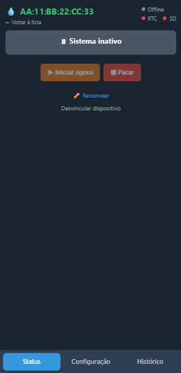
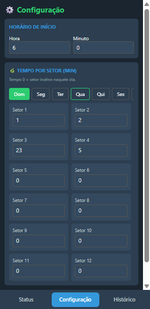
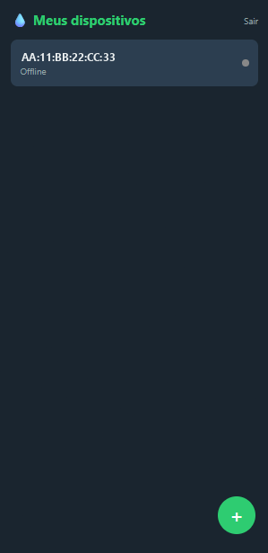
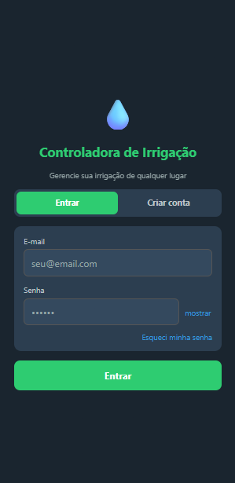

# 💧 Controladora de Irrigação — App

App **React Native (Expo SDK 56)** para monitorar e configurar controladores de
irrigação setorial baseados em **ESP32**. Uma conta pode gerenciar vários
dispositivos: cada um tem 12 setores, uma programação semanal de tempos e
histórico próprio.

O app **não conversa diretamente com o hardware**. App e ESP32 se comunicam
exclusivamente através do **Firebase** (Firestore + Cloud Functions) — isso
permite controlar a irrigação de qualquer lugar, sem estar na mesma rede do
dispositivo e sem abrir portas no roteador.

> Firmware do ESP32 (repositório separado): `irrigacao_setorial_freertos` — ESP32 + FreeRTOS.

<p align="center">
  
  
  
</p>

---

## Funcionalidades

- **Multi-dispositivo** — uma conta, vários controladores, com apelido editável por dispositivo.
- **Pareamento por código de 6 caracteres** — sem digitar MAC, sem cadastro manual.
- **Status em tempo real** — setor em irrigação, tempo restante, barra de progresso, dia do ciclo e indicador online/offline (listener do Firestore, sem polling).
- **Comandos manuais** — iniciar ou parar a irrigação na hora.
- **Programação semanal** — hora de início e o tempo em minutos de cada um dos 12 setores, para cada dia da semana.
- **Histórico paginado** — registros de irrigação gravados pelo ESP32.
- **Diagnóstico de hardware** — indicadores de RTC, cartão SD e sensor de fluxo (quando o firmware os reporta). Se o sensor de fluxo está conectado e não detecta água, o app avisa que o ESP32 pausou a contagem de tempo.
- **Autenticação e-mail/senha** com sessão persistente e exigência de senha forte no cadastro.
- **Roda em Android, iOS e web** a partir do mesmo código.

---

## Como funciona

```
┌─────────────┐      config/ comandos/      ┌──────────────────┐
│     App     │ ──────────────────────────► │                  │
│  Expo / RN  │                             │     Firebase     │
│             │ ◄────── status/ logs/ ───── │                  │
└─────────────┘                             │    Firestore     │
                                            │        +         │
┌─────────────┐ ─────── status/ logs/ ────► │  Cloud Functions │
│    ESP32    │                             │                  │
│  FreeRTOS   │ ◄──── config/ comandos/ ─── │                  │
└─────────────┘                             └──────────────────┘
```

Nenhum dos dois lados fala com o outro diretamente. O ESP32 autentica no
Firestore com um **Custom Token** com claims `deviceMac`/`ownerUid`, e as regras
de segurança restringem cada dispositivo ao caminho do seu próprio dono.

### Pareamento de um dispositivo novo

```
App                          Firebase                        ESP32
 │                              │                              │
 │─ gerarCodigoVinculacao() ───►│                              │
 │◄──── "A3F7K2" (15 min) ──────│                              │
 │                              │                              │
 │  o usuário conecta no AP "irrigacao-setup" (192.168.4.1)    │
 │  e digita Wi-Fi + senha + código no portal cativo ─────────►│
 │                              │                              │
 │                              │◄── vincularComCodigo() ──────│
 │                              │──── Custom Token ───────────►│
 │                              │                              │
 │◄─ onSnapshot detecta o novo MAC em /users/{uid}/controllers  │
 │   e abre o painel do dispositivo                             │
```

---

## Telas

| Tela | Arquivo | O que faz |
|---|---|---|
| Login / cadastro | `src/screens/AuthScreen.tsx` | E-mail e senha, recuperação de senha, medidor de força de senha no cadastro |
| Meus dispositivos | `src/app/index.tsx` | Lista os controladores da conta com status resumido; botão "+" para parear |
| Adicionar dispositivo | `src/app/adicionar-dispositivo.tsx` | Mostra o código de 6 caracteres com contagem regressiva e as instruções do portal cativo |
| Status | `src/app/device/[mac]/index.tsx` | Painel do dispositivo: setor atual, progresso, iniciar/parar, renomear, desvincular |
| Configuração | `src/app/device/[mac]/config.tsx` | Hora de início e os 12 tempos de setor por dia da semana |
| Histórico | `src/app/device/[mac]/logs.tsx` | Lista paginada dos ciclos registrados pelo ESP32 |

<p align="center">
  
</p>

---

## Stack

| | |
|---|---|
| Framework | Expo SDK 56 · React Native 0.85 · React 19 |
| Navegação | Expo Router 56 (rotas por arquivo; abas nativas via `expo-router/unstable-native-tabs`) |
| Backend | Firebase JS SDK v12 — Firestore, Auth, Cloud Functions (`us-central1`) |
| Linguagem | TypeScript |
| Armazenamento local | `expo-secure-store` (último dispositivo aberto) · AsyncStorage (sessão do Auth) |

Usa o **Firebase JS SDK**, não `@react-native-firebase` — assim o app roda no
Expo Go, sem build nativo.

---

## Rodando o projeto

```bash
npm install
npm start          # servidor de desenvolvimento (ler o QR code no Expo Go)

npm run android    # abre no Android
npm run ios        # abre no iOS
npm run web        # abre no navegador

npx tsc --noEmit   # verificação de tipos
```

Para apontar o app para o seu próprio projeto Firebase, troque os valores de
`src/lib/firebaseConfig.ts` e faça o deploy das Cloud Functions e das
`firestore.rules` que estão na pasta `firebase/` do repositório do firmware.

> Não há suíte de testes. `npx tsc --noEmit` é a principal ferramenta de
> verificação do projeto.

---

## Estrutura

```
src/
├── app/                        # rotas do Expo Router
│   ├── _layout.tsx             # AuthProvider → AppProvider → Stack
│   ├── index.tsx               # lista de dispositivos
│   ├── adicionar-dispositivo.tsx
│   └── device/[mac]/           # abas por dispositivo
│       ├── _layout.tsx         # NativeTabs (nativo)
│       ├── _layout.web.tsx     # Tabs de expo-router/ui (web)
│       ├── index.tsx           # Status
│       ├── config.tsx          # Configuração
│       └── logs.tsx            # Histórico
├── contexts/                   # AuthContext, AppContext, DeviceMacContext
├── services/                   # firebase.ts (Firestore + Functions), auth.ts
├── lib/                        # firebaseConfig, mac, passwordStrength
├── screens/                    # telas que não são rotas (AuthScreen)
├── components/                 # toast, etc.
└── constants/                  # irrigation.ts (cores, DIAS, NUM_SETORES = 12)
```

Só arquivos dentro de `src/app/` se tornam rotas.

---

## Modelo de dados

Tudo fica sob `/users/{uid}/controllers/{mac}/`, onde `{mac}` é o MAC do ESP32
em 12 hex maiúsculos sem separador (`8813BF002C9C`).

| Caminho | Escreve | Lê |
|---|---|---|
| `controllers/{mac}` | Cloud Function no pareamento; campo `nome` pelo app | App |
| `config/main` | App | ESP32 |
| `status/main` | ESP32 | App (em tempo real) |
| `comandos/{id}` | App | ESP32 |
| `logs/{id}` | ESP32 | App (paginado) |

Detalhes do formato:

- `tempos` em `config/main` é um **mapa** de dia da semana (`"0"`–`"6"`) para um
  array de 12 minutos — o Firestore não aceita array dentro de array.
- `status.setorAtual` é 0-based (0–11); `-1` significa parado. O app soma 1 na
  exibição ("Setor 1"–"Setor 12").
- Comandos são documentos com `processado: false`; o ESP32 executa e marca
  `processado: true`. O app dispara e confia no listener de `status` para
  refletir o resultado.
- O ESP32 manda heartbeat a cada 1 h; o app considera o dispositivo offline
  após 90 min sem atualização.

### Cloud Functions

| Função | Chamador | O que faz |
|---|---|---|
| `gerarCodigoVinculacao` | App (autenticado) | Cria um código de 6 caracteres válido por 15 min |
| `vincularComCodigo` | ESP32 (HTTP, sem auth) | Troca código + MAC por um Custom Token e cria o documento do controlador |
| `desvincularDispositivo` | App (autenticado) | Remove o controlador da conta e revoga o token do dispositivo |

O código das functions e as regras do Firestore ficam na pasta `firebase/` do
repositório do firmware, que é a fonte de verdade do contrato do backend.

---

## Configuração fixa de hardware

`NUM_SETORES = 12` e os 7 dias da semana são restrições do hardware, definidas
em `src/constants/irrigation.ts`. Não são configuráveis pela interface.

---

## Licença

MIT — veja [LICENSE](LICENSE).
